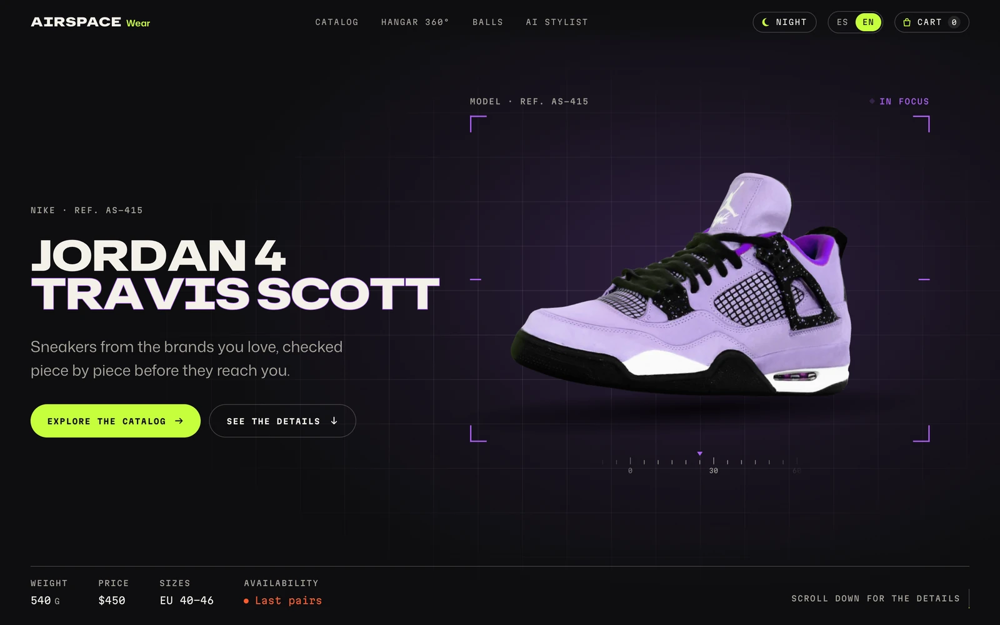
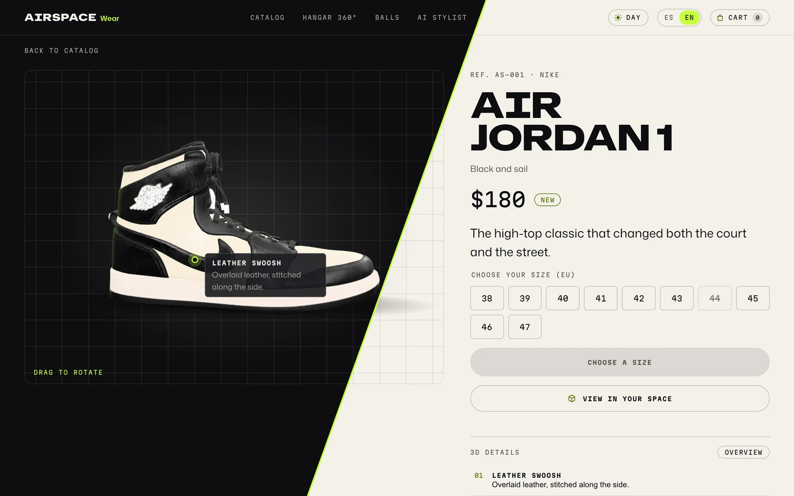
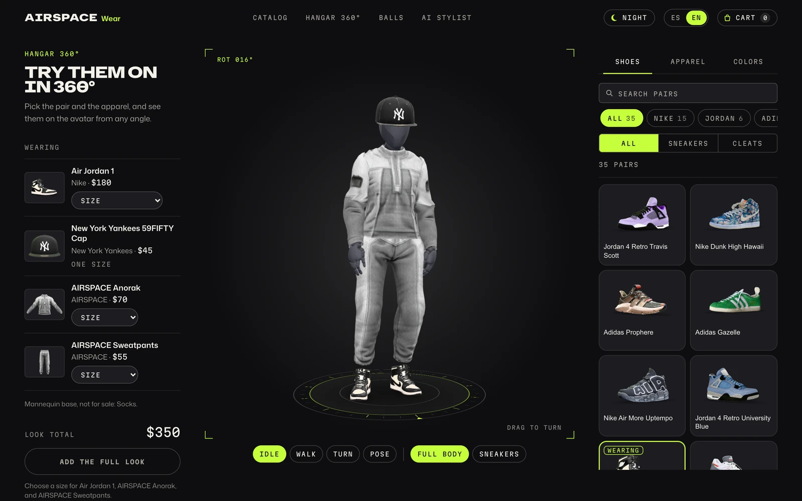
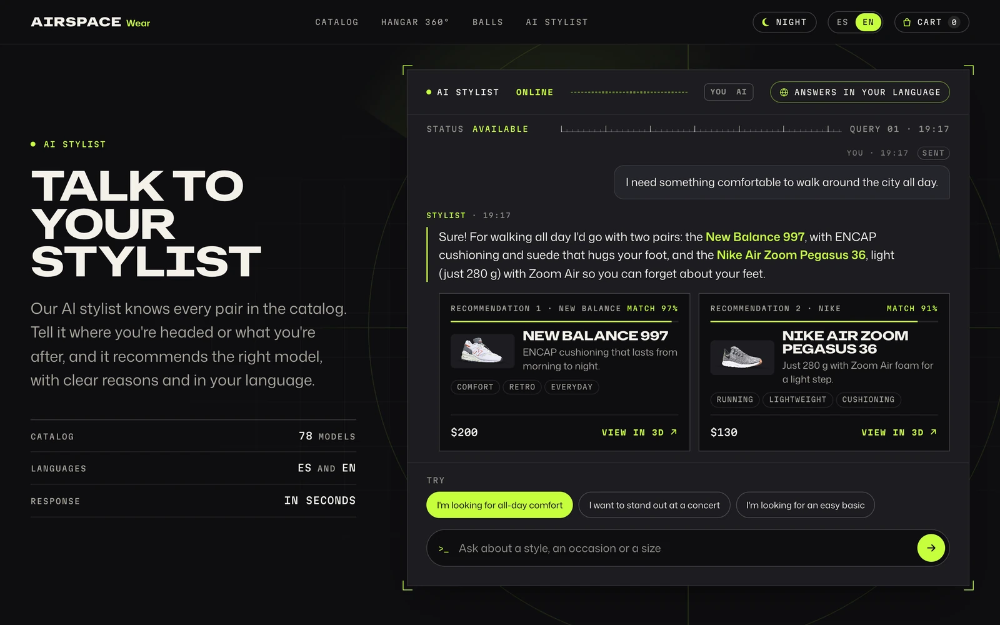
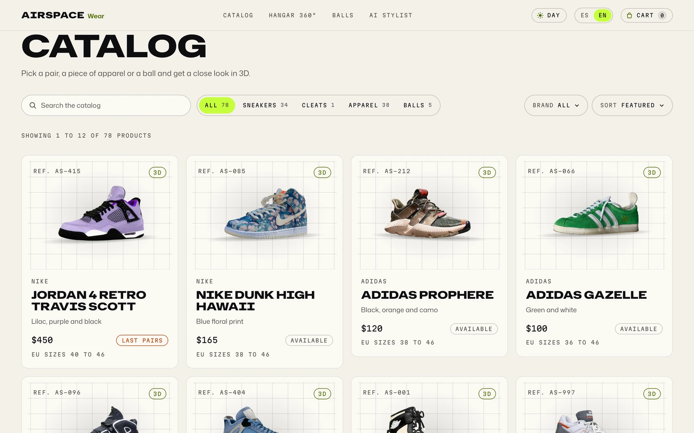
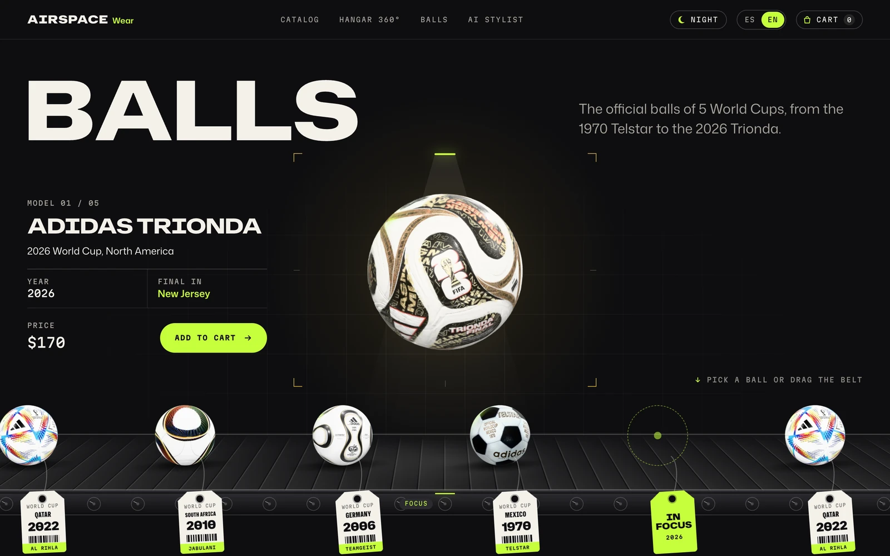
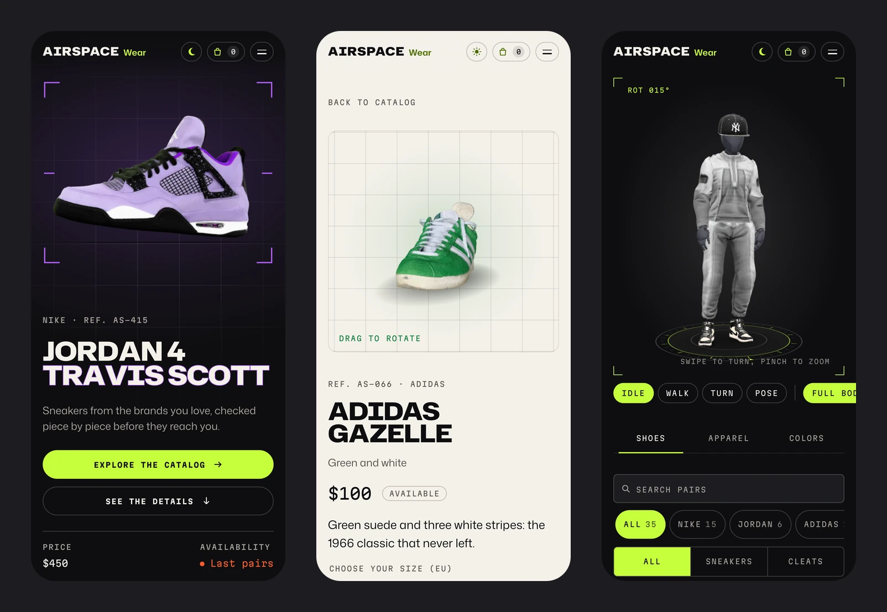

# AIRSPACE Wear

A multi-brand store for sneakers, apparel and soccer balls, built around 3D. Turn every product in your hand, place it in your room with AR, dress a 360° avatar and ask an AI stylist what to wear.

**Live demo:** https://airspace-wear-web.vercel.app

> **Portfolio project. Not affiliated with any brand shown.** Every name, logo and design belongs to its owner and appears only to illustrate the project. Prices, sizes and stock are sample data, and nothing is sold.



## Features

- **3D product pages:** cinematic sequences that play on their own, hotspots you can reach by keyboard, and drag (or arrow keys) to turn the model.
- **AR view** with `model-viewer`: WebXR on Android, Quick Look on iOS, placed at real size.
- **Hangar 360°:** an animated Mixamo avatar that walks, turns and poses wearing the sneakers and the compatible apparel you pick.
- **AI stylist** (Claude) that recommends products from the catalog only, streams its answer and replies in your language, with a scripted demo when it is offline.
- **Login with Google** (Better Auth): a user menu with avatar in the header, sessions stored in Postgres and verified by the API.
- **Catalog** of 78 products (sneakers, cleats, apparel and World Cup balls) with search, filters, sorting and a local cart.
- **Spanish and English** on every screen, **light and dark themes** with no flash on load.
- **Full motion** that never hijacks the scroll, respects `prefers-reduced-motion` and has a lite mode for modest devices.

## Gallery

| | |
| --- | --- |
|  |  |
| **Product page:** 3D viewer with hotspots, in dark and light | **Hangar 360°:** the avatar wears the pair and apparel you pick |
|  |  |
| **AI stylist:** recommendations built from real catalog data | **Catalog:** search, categories, brand filter and sorting |
|  |  |
| **Balls:** five World Cup balls on a draggable belt | **Phones:** every screen is designed for mobile too |

## Tech stack

| Area | Tools |
| --- | --- |
| Web (`apps/web`) | Next.js 16 (App Router, Cache Components), React 19, TypeScript, next-intl, React Three Fiber, drei, model-viewer, GSAP, Motion, Lenis, CSS Modules |
| API (`apps/api`) | NestJS 12 (ESM), Prisma 7, PostgreSQL 18, Anthropic SDK |
| Shared (`packages/contracts`) | zod schemas used by both the web and the API |
| 3D pipelines | gltf-transform, meshoptimizer, sharp, Blender (avatar), Playwright (posters) |
| Tooling | pnpm 11 workspaces, Node 22+, Docker Compose, Vitest, Playwright, ESLint, oxlint |
| Hosting | Vercel (web and API), Neon Postgres, Vercel Blob (avatar) |

## Quick start

**Prerequisites:** Node.js 22 or later, pnpm 11 (`corepack enable` picks the pinned version) and Docker with Compose v2.

```bash
pnpm install
cp .env.example .env      # every variable is optional in development
pnpm db:up                # Postgres on 127.0.0.1:5434
pnpm db:migrate           # apply the Prisma migrations
pnpm db:seed              # load the catalog (repeatable)
pnpm dev                  # web on http://localhost:3000, API on http://127.0.0.1:4000
```

Open http://localhost:3000 (it redirects to `/es`, the default locale; `/en` is English). The optimized 3D models and posters are committed, so the site works right after cloning. Without an Anthropic API key the stylist plays its scripted demo. The Hangar 360° avatar is not committed (Mixamo license); see [Hangar 360° avatar](docs/development.md#hangar-360-avatar-scriptsavatar) to build it.

## Scripts

| Script | What it does |
| --- | --- |
| `pnpm dev` | Builds the contracts, then runs contracts (watch), API and web in parallel. |
| `pnpm build` | Builds every package. The web build needs the API running. |
| `pnpm lint` / `pnpm typecheck` | Lints and type-checks every package. |
| `pnpm test` | Unit tests (Vitest). |
| `pnpm test:e2e` | API integration tests against the `airspace_test` database. |
| `pnpm db:up` / `pnpm db:down` | Starts or stops the local Postgres. |
| `pnpm db:migrate` / `pnpm db:seed` | Applies migrations and loads the catalog. |
| `pnpm docker:up` / `pnpm docker:down` | Runs the full stack in containers (web on :3001, API on :4001). |
| `pnpm models` | Runs the 3D pipeline: download, optimize and credits. |

Every script, the environment variables, the architecture, the 3D and avatar pipelines, testing, Docker and the Vercel deployment are documented in **[docs/development.md](docs/development.md)**.

## Project layout

```
apps/web/              Next.js site (next-intl, R3F); messages/ holds the es and en texts
apps/web/public/       optimized GLB models, posters, fitted avatar apparel, smoke atlas
apps/api/              NestJS API (Prisma schema, migrations and seed in prisma/)
packages/contracts/    zod schemas shared by web and API
scripts/               3D model, avatar and effects pipelines, design preview server
assets/                model and avatar manifests (raw downloads are git ignored)
design/prototype/      static design and motion prototype (reference only)
docs/                  development guide, plans and screenshots
CREDITS.md             third-party credits
```

## Credits and licenses

Every third-party asset (3D models, the Mixamo avatar and animations, fonts, libraries) is credited with its author, source, license and the changes made in [`CREDITS.md`](CREDITS.md) and on the `/credits` page of the site. The fonts (Hubot Sans, Mona Sans and Martian Mono) use the SIL Open Font License, and most 3D models are CC BY 4.0.

**License note:** the Adidas Samba model is **CC BY-NC-SA 4.0** (non-commercial, share-alike). It is fine for this portfolio, but it must be removed or replaced if the project ever becomes commercial.
